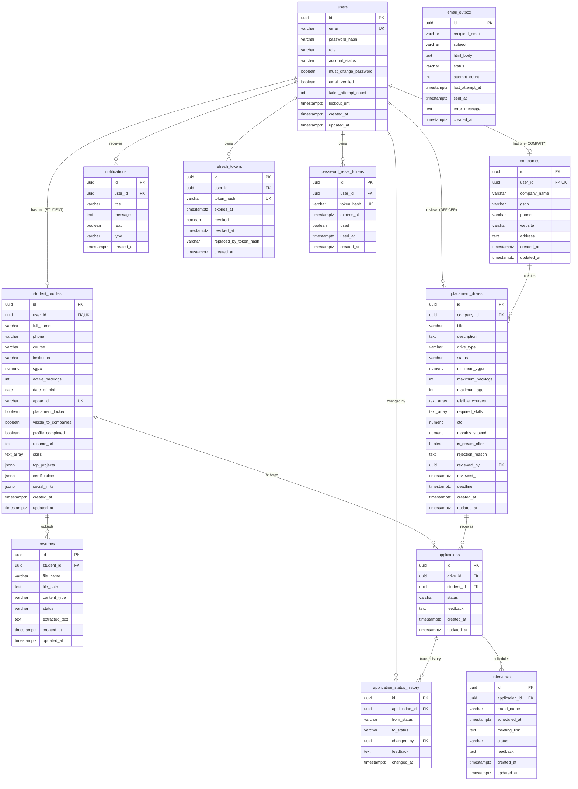

# Placement Setu — Database Schema & Entity-Relationship Architecture

**Platform:** Placement Setu
**Institution:** Gujarat Vidyapith, Ahmedabad
**Database Engine:** PostgreSQL 15+
**Schema Management:** Flyway Versioned Migrations (`V1` through `V11`)

---

## 1. Entity-Relationship Diagram (Mermaid ERD)

---

## 2. Table Specifications & Schema Details

### 2.1 `users` Table
- **Purpose:** Central authentication identity record for all system users across all roles.
- **Introduced / Modified in:** `V1`, `V6`, `V9`.
- **Primary Key:** `id` (`UUID`).
- **Key Columns:**
  - `email`: Normalized, lowercased unique login identifier.
  - `password_hash`: BCrypt hashed secret.
  - `role`: Enum `STUDENT`, `COMPANY`, `PLACEMENT_OFFICER`, `ADMIN`.
  - `account_status`: Enum `PENDING`, `ACTIVE`, `SUSPENDED`, `REJECTED`.
  - `must_change_password`: Flag set to `TRUE` for officer-provisioned companies.
  - `failed_attempt_count`: Counter for consecutive bad password attempts.
  - `lockout_until`: Timestamp indicating when account lockout expires (5 failed attempts = 15 minutes).

### 2.2 `student_profiles` Table
- **Purpose:** University student profile, academic records, verified skills, and placement lock status.
- **Introduced / Modified in:** `V1`, `V11`.
- **Primary Key:** `id` (`UUID`).
- **Key Columns:**
  - `user_id`: One-to-one foreign key to `users(id)`.
  - `appar_id`: National student APPAR / Enrollment identifier (Unique).
  - `cgpa`, `active_backlogs`: Academic metrics evaluated by the policy engine.
  - `placement_locked`: Set to `TRUE` upon securing a standard job offer ("One Student One Job" rule).
  - `skills`: PostgreSQL array `TEXT[]` storing normalized skills. Indexed via GIN in `V11`.
  - `top_projects`, `certifications`, `social_links`: Extensible JSONB structures populated by AI parsing.

### 2.3 `companies` Table
- **Purpose:** Vetted partner recruiters and corporate organizations provisioned by the Placement Officer.
- **Introduced in:** `V1`.
- **Primary Key:** `id` (`UUID`).
- **Key Columns:**
  - `user_id`: One-to-one foreign key to `users(id)`.
  - `company_name`: Corporate legal title.
  - `gstin`: GST / Tax registration code.
  - `website`, `phone`, `address`: Official corporate contact credentials.

### 2.4 `placement_drives` Table
- **Purpose:** Campus recruitment drives, hiring parameters, stipends/compensation, and officer review state.
- **Introduced / Modified in:** `V1`, `V3`, `V5`, `V10`, `V11`, `V13`.
- **Primary Key:** `id` (`UUID`).
- **Key Columns:**
  - `company_id`: Foreign key to `companies(id)`.
  - `status`: Enum `DRAFT`, `PENDING_APPROVAL`, `PUBLISHED`, `REJECTED`, `CLOSED` (default `DRAFT`).
  - `drive_type`: Enum `FULL_TIME`, `PAID_INTERNSHIP`, `INTERNSHIP_TO_PPO`.
  - `minimum_cgpa`, `maximum_backlogs`, `maximum_age`: Policy evaluation thresholds.
  - `stipend`: Minimum ₹10,000 for paid internships.
  - `ctc`: Annual Cost-to-Company compensation.
  - `is_dream_offer`: Allows already placed students to apply if CTC $\ge$ 8.0 LPA.
  - `submitted_at`: Timestamp when company submitted/resubmitted the drive for PO approval.
  - `review_remarks`: Mandatory Placement Officer remarks recorded upon approval or rejection.
  - `rejection_reason`: Legacy/compatible feedback recorded upon rejection.
  - `reviewed_by`, `reviewed_at`: Foreign key to `users(id)` and timestamp of officer approval/rejection.

### 2.5 `applications` Table
- **Purpose:** Formal applications submitted by eligible students to published drives.
- **Introduced / Modified in:** `V1`, `V8`.
- **Primary Key:** `id` (`UUID`).
- **Key Columns:**
  - `drive_id`: Foreign key to `placement_drives(id)`.
  - `student_id`: Foreign key to `student_profiles(id)`.
  - `status`: Enum `APPLIED`, `UNDER_REVIEW`, `SHORTLISTED`, `INTERVIEW_SCHEDULED`, `SELECTED`, `REJECTED`.
  - `feedback`: Interviewer or recruiter notes.

### 2.6 `application_status_history` Table
- **Purpose:** Immutable audit trail recording every state change in an application's lifecycle.
- **Introduced in:** `V8`.
- **Primary Key:** `id` (`UUID`).
- **Key Columns:**
  - `application_id`: Foreign key to `applications(id)`.
  - `from_status`: Originating status.
  - `to_status`: New status.
  - `changed_by`: Foreign key to `users(id)` (officer or recruiter).
  - `feedback`: Reason or review comments.
  - `changed_at`: Transition timestamp.

### 2.7 `interviews` Table
- **Purpose:** Assessment rounds and technical/HR interview scheduling.
- **Introduced in:** `V1`.
- **Primary Key:** `id` (`UUID`).
- **Key Columns:**
  - `application_id`: Foreign key to `applications(id)`.
  - `round_name`: Title of round (e.g. "Technical Interview 1", "HR Fitment").
  - `scheduled_at`, `meeting_link`: Logistics details.
  - `status`: Interview outcome state.

### 2.8 `resumes` Table
- **Purpose:** Student individual resume files and AI text extraction status.
- **Introduced in:** `V1` (Batch tables `resume_batch_jobs` and `resume_batch_items` dropped in `V7`).
- **Primary Key:** `id` (`UUID`).
- **Key Columns:**
  - `student_id`: Foreign key to `student_profiles(id)`.
  - `file_name`, `file_path`: Storage location and original filename.
  - `status`: Enum `UPLOADED`, `PROCESSING`, `COMPLETED`, `FAILED`.
  - `extracted_text`: Raw plain text extracted via Apache PDFBox / Apache POI.

### 2.9 `notifications` Table
- **Purpose:** In-app notification bell items delivered to users.
- **Introduced in:** `V1`, `V4`.
- **Primary Key:** `id` (`UUID`).
- **Key Columns:**
  - `user_id`: Recipient user.
  - `title`, `message`: Notification content.
  - `read`: Read/unread status flag.

### 2.10 `email_outbox` Table
- **Purpose:** Transactional email outbox pattern preventing email loss during network failures.
- **Introduced in:** `V4`.
- **Primary Key:** `id` (`UUID`).
- **Key Columns:**
  - `recipient_email`, `subject`, `html_body`: Email payload.
  - `status`: `PENDING`, `SENT`, `FAILED`, `SKIPPED`.
  - `attempt_count`: Delivery retry count with exponential backoff.

### 2.11 `refresh_tokens` Table
- **Purpose:** Database-backed refresh tokens supporting rotation, reuse detection, and session revocation.
- **Introduced in:** `V9`.
- **Primary Key:** `id` (`UUID`).
- **Key Columns:**
  - `user_id`: Foreign key to `users(id)`.
  - `token_hash`: SHA-256 hashed refresh token string (Unique).
  - `expires_at`: Absolute expiration timestamp.
  - `revoked`, `revoked_at`: Revocation tracking.
  - `replaced_by_token_hash`: Hash of the new rotated token issuing from this token.

### 2.12 `password_reset_tokens` Table
- **Purpose:** Single-use recovery tokens for password reset workflows.
- **Introduced in:** `V9`.
- **Primary Key:** `id` (`UUID`).
- **Key Columns:**
  - `user_id`: Foreign key to `users(id)`.
  - `token_hash`: Unique SHA-256 token hash.
  - `expires_at`: Expiration timestamp (typically 30 minutes).
  - `used`, `used_at`: Consumed state tracking.

---

## 3. Migration Lineage

| Migration | Title | Purpose |
| :--- | :--- | :--- |
| `V1` | `V1__placement_setu_schema.sql` | Baseline tables (`users`, `student_profiles`, `companies`, `placement_drives`, `applications`, `interviews`, `notifications`, `resumes`) |
| `V2` | `V2__seed_data.sql` | Initial administrative user seeds |
| `V3` | `V3__add_drive_status_draft_published.sql` | Adds `DRAFT` and `PUBLISHED` enum states |
| `V4` | `V4__notification_and_email_outbox.sql` | Adds `email_outbox` table and notification indexes |
| `V5` | `V5__resume_batch_processing_and_policies.sql` | Legacy batch upload tables and policy constraints |
| `V6` | `V6__company_onboarding_and_password_policy.sql` | Adds `must_change_password` to `users` |
| `V7` | `V7__remove_resume_batch_tables.sql` | Drops `resume_batch_jobs` and `resume_batch_items` |
| `V8` | `V8__application_pipeline_and_audit_history.sql` | Adds `application_status_history` and `feedback` to `applications` |
| `V9` | `V9__auth_hardening_and_token_management.sql` | Adds `failed_attempt_count`, `lockout_until`, `refresh_tokens`, and `password_reset_tokens` |
| `V10` | `V10__placement_drive_officer_approval_workflow.sql` | Adds `rejection_reason`, `reviewed_by`, and `reviewed_at` to `placement_drives` |
| `V11` | `V11__candidate_matching_indexes.sql` | Adds GIN index on `student_profiles(skills)` and B-Tree indexes on `cgpa` and `active_backlogs` |
| `V12` | `V12__student_profile_officer_approval.sql` | Adds `approval_status`, `review_remarks`, `reviewed_by`, `reviewed_at` to `student_profiles` |
| `V13` | `V13__placement_drive_po_approval_and_review_remarks.sql` | Adds `review_remarks` and `submitted_at` to `placement_drives`, removes obsolete `OPEN` from `drive_status` enum, sets default `DRAFT`, adds `DRIVE_SUBMITTED` notification type |
