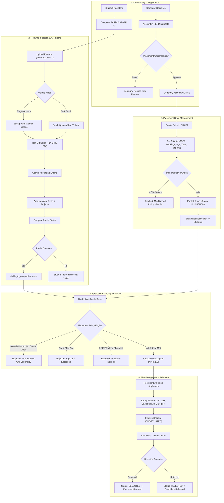
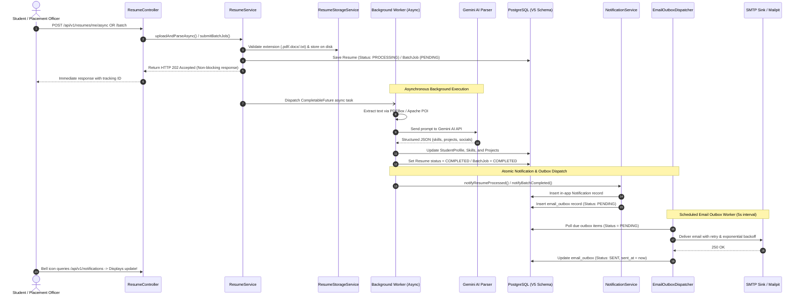
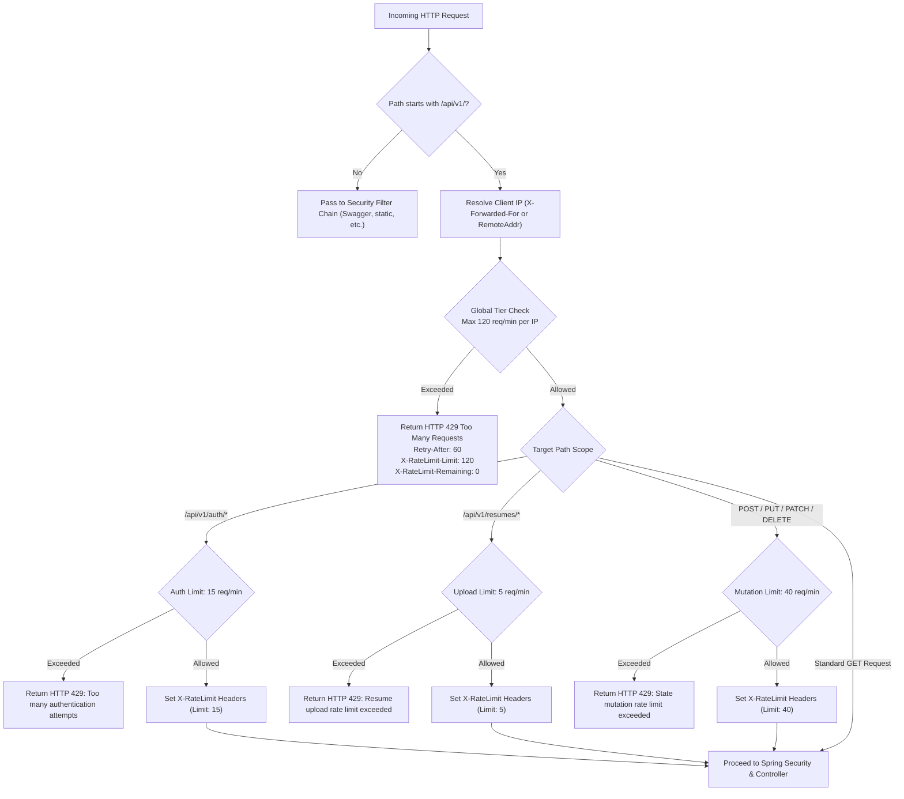
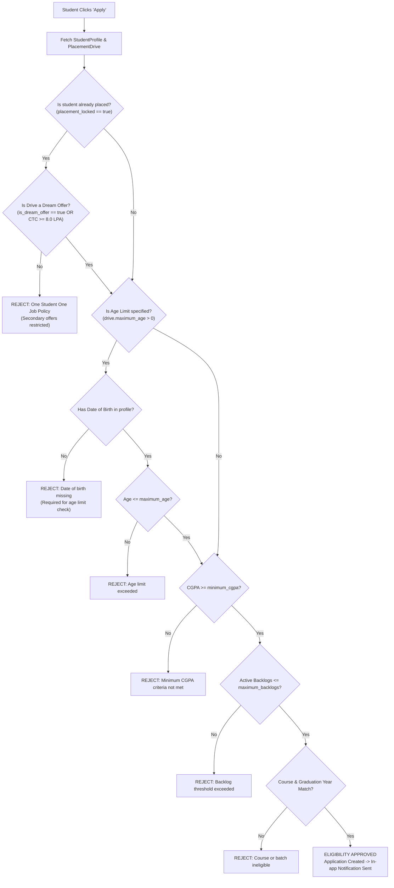

# Placement Setu: Project Pipelines & Workflow Architecture

**Platform:** Placement Setu (Gujarat Vidyapith Campus Placement Platform)  
**Document:** End-to-End Architecture Pipelines, Asynchronous Processing & Security Flows  

---

## 1. Overall Campus Placement Lifecycle Pipeline

The diagram below illustrates the end-to-end institutional workflow from student and company onboarding to placement drives, policy evaluation, shortlisting, and final job offer.

---

## 2. Background Asynchronous & Batch Resume Parsing Pipeline

This pipeline details how student single uploads and officer batch uploads are processed without blocking web threads, complete with failure isolation, rate limits, and notifications.

---

## 3. Universal Multi-Tier Rate Limiting Pipeline

All incoming requests entering the Placement Setu platform pass through the unified `RateLimitingFilter`:

---

## 4. Institutional Policy Engine Evaluation Pipeline

Before any student application is persisted or placement drive is authorized, it passes through the `PlacementPolicyService`:

---

## 5. Security & Build Quality Pipeline

```mermaid
flowchart LR
    subgraph Dev["Development & Code Hygiene"]
        D1["Java 17 / Spring Boot 3.2.5"] --> D2["Modular Monolith Architecture"]
        D2 --> D3["Versioned Flyway Migrations (V1-V5)"]
    end

    subgraph Security["Security Verification"]
        D3 --> S1["Parameterized SQL (No SQLi)"]
        S1 --> S2["XSS Escaping (HtmlUtils)"]
        S2 --> S3["Directory Traversal Guard"]
        S3 --> S4["Rate Limiting Filter"]
        S4 --> S5["Disabled Sourcemaps (Vite)"]
    end

    subgraph Ops["Operational Reliability"]
        S5 --> O1["Transactional Outbox (No Lost Emails)"]
        O1 --> O2["Bounded Exponential Backoff"]
        O2 --> O3["Safe Dev Sandbox (SKIPPED Status)"]
    end
```

