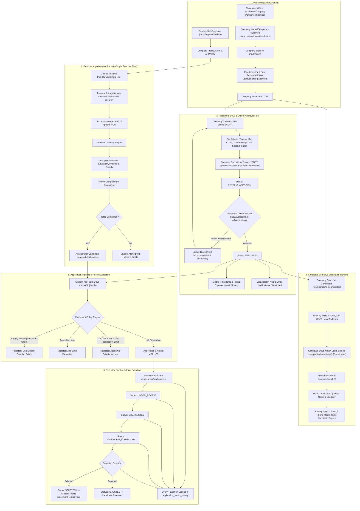
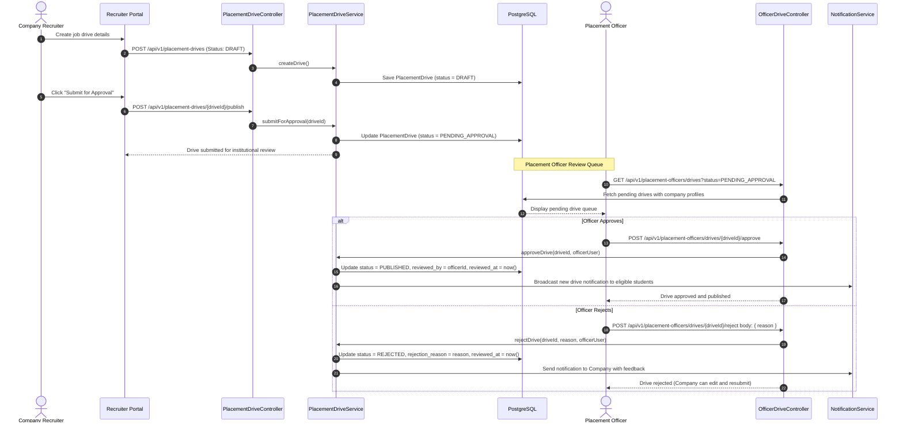
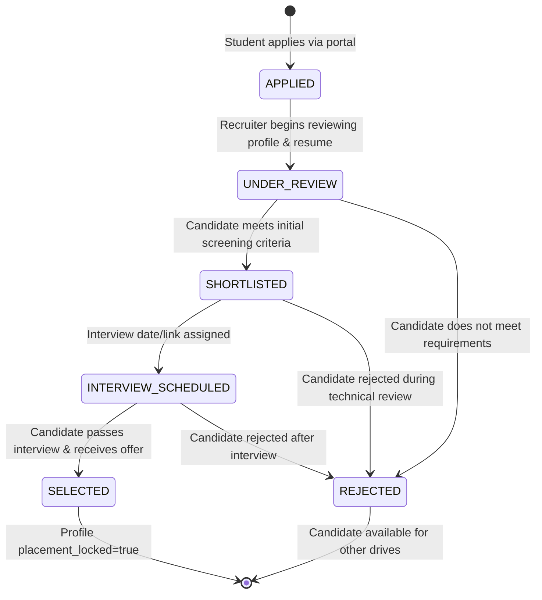
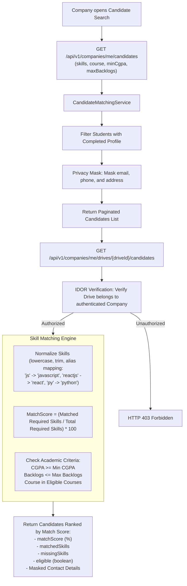
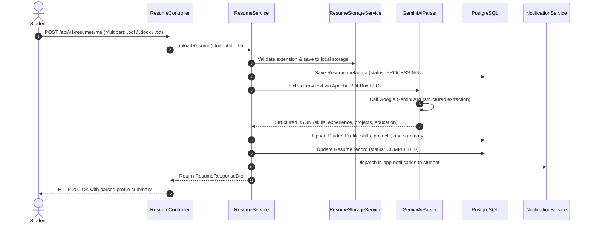
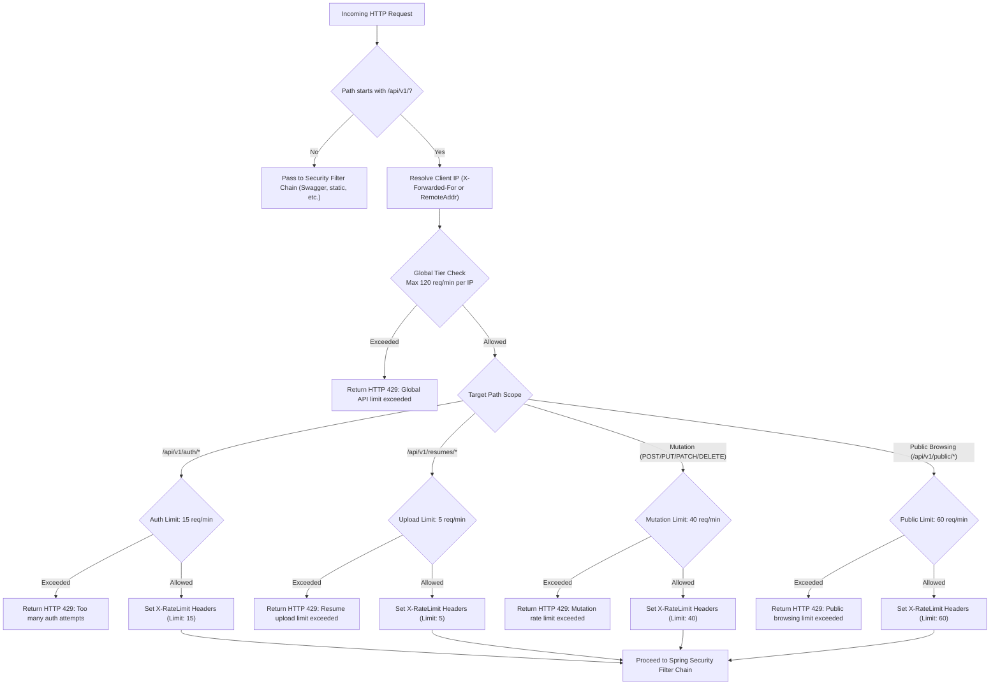

# Placement Setu: Project Pipelines & Workflow Architecture

**Platform:** Placement Setu (Gujarat Vidyapith Campus Placement Platform)
**Document:** End-to-End Architecture Pipelines, Asynchronous Processing, Drive Approval & Security Flows

---

## 1. Overall Campus Placement Lifecycle Pipeline

The diagram below illustrates the end-to-end institutional workflow from student enrollment and company provisioning to placement drive approval, candidate matching, application evaluation, and final job offer locking.

---

## 2. Drive Approval Workflow Pipeline

To safeguard students against substandard or unauthorized job postings, companies cannot publish drives directly to students:

---

## 3. Application Pipeline & Audit History

All student applications progress through explicit pipeline stages. Every status change creates an immutable audit row in `application_status_history`:

### Audit Log Schema (`application_status_history`)
Every transition captures:
- `id`: UUID (Primary Key)
- `application_id`: UUID (FK to `applications`)
- `from_status`: Previous `ApplicationStatus` (nullable for initial creation)
- `to_status`: New `ApplicationStatus`
- `changed_by`: UUID (FK to `users`, the recruiter or officer who transitioned the status)
- `feedback`: String (Optional interview feedback, rejection reason, or score notes)
- `changed_at`: Timestamp (UTC)

---

## 4. Candidate Search & Match Score Pipeline

Recruiters (`ROLE_COMPANY`) can search the university candidate database and inspect match scores against specific job drives:

---

## 5. Single Resume Ingestion & Asynchronous AI Parsing

Batch resume uploads are fully removed; each student manages their own individual resume:

---

## 6. Multi-Tier Security & Rate Limiting Pipeline

All incoming HTTP requests pass through the unified `RateLimitingFilter`:

